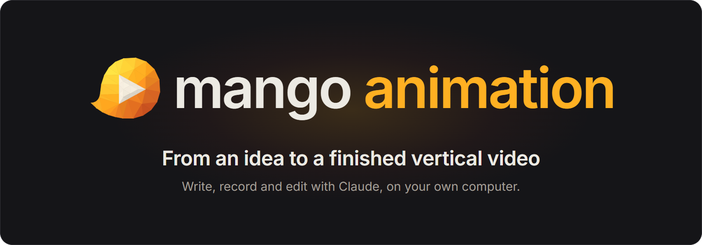
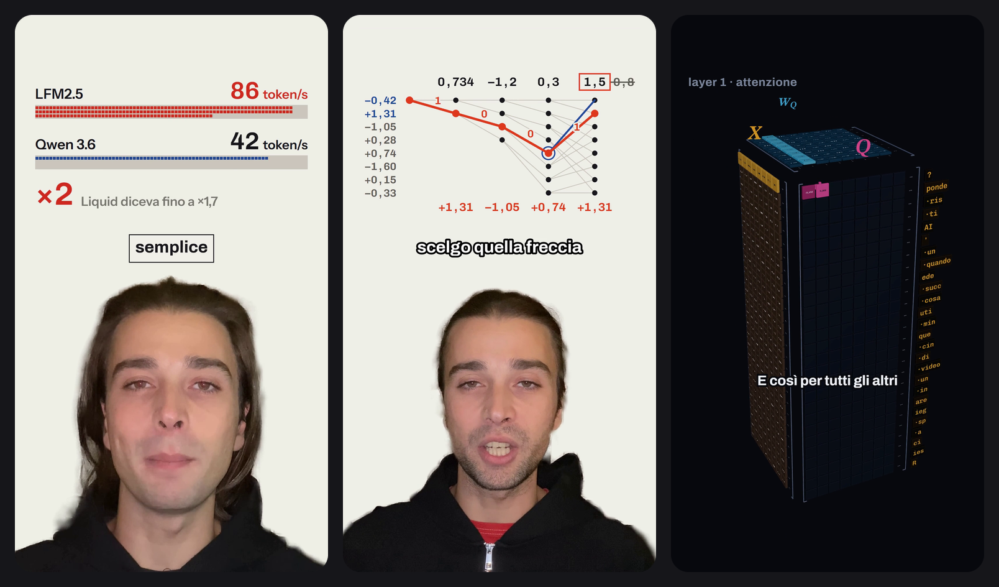
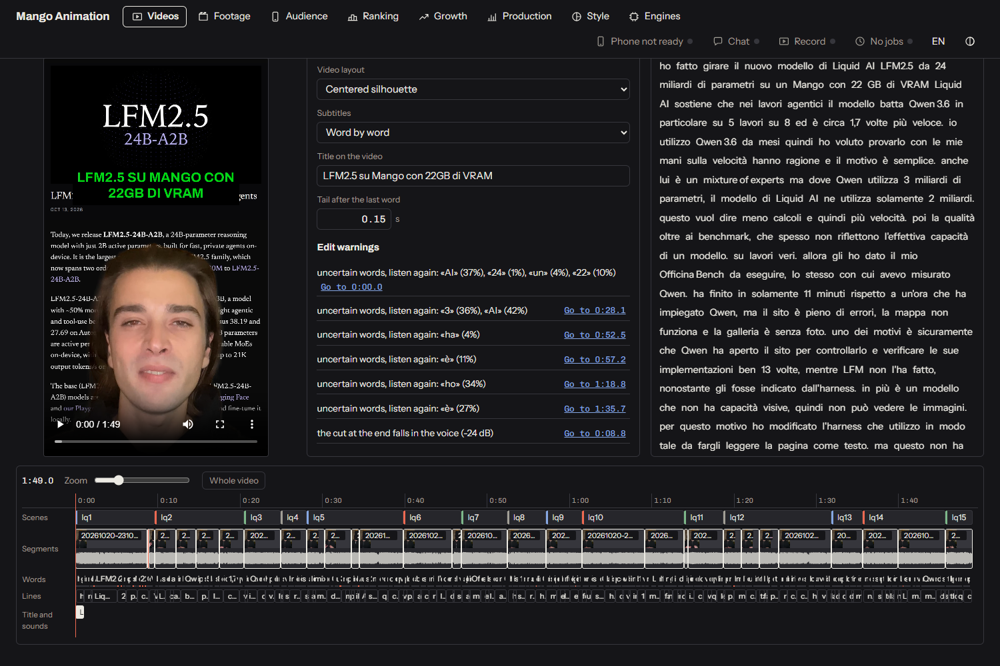
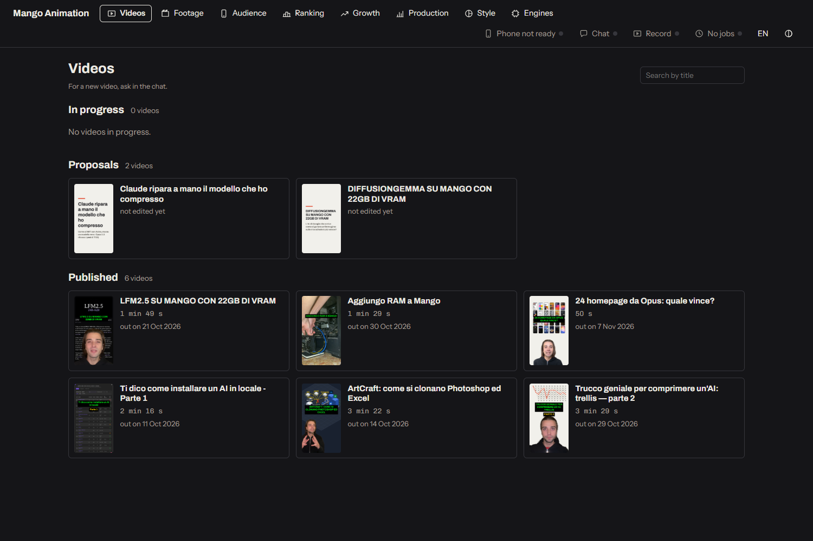
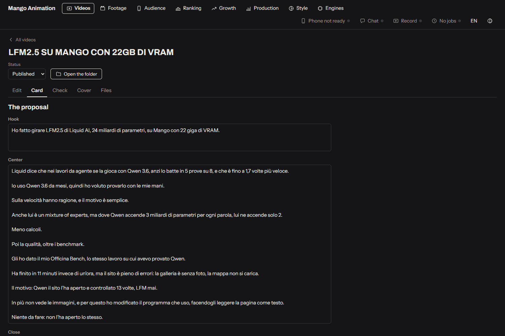
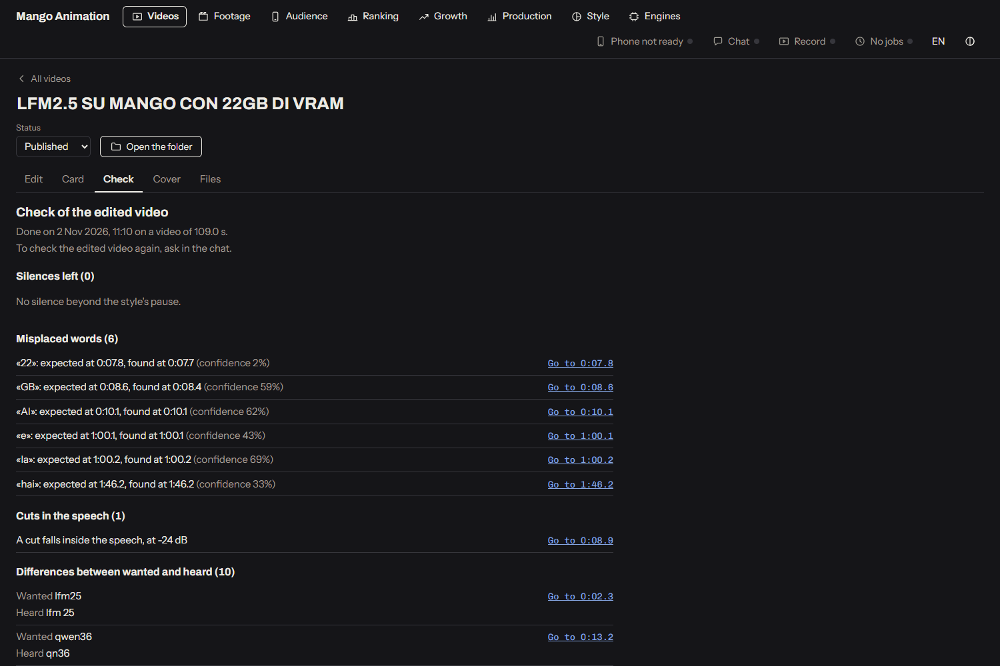
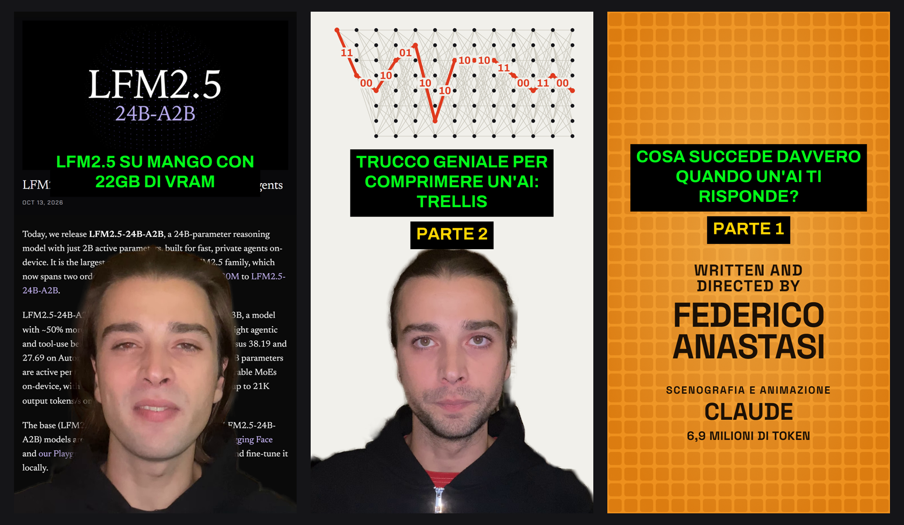

  

  
  
  
  
  

  <b>You talk, Claude writes and edits, your footage never leaves your computer.</b>

  <a href="#what-it-does">What it does</a> ·
  <a href="#how-a-video-is-made">How a video is made</a> ·
  <a href="#features">Features</a> ·
  <a href="#screenshots">Screenshots</a> ·
  <a href="#install">Install</a> ·
  <a href="#privacy">Privacy</a> ·
  <a href="#for-developers">For developers</a> ·
  <a href="#license">License</a>

## What it does

Mango Animation is a Windows app for people who make short vertical videos: explainers, opinions, news, tutorials, for
TikTok, Reels, Shorts or YouTube. You bring an idea or some footage; Claude, in a chat inside the app, proposes the angle
and the script, prepares a rehearsal to record against, picks your best takes, and edits the video: your silhouette cut
out over animated scenes or real pages, word-by-word subtitles, cuts that never fall in the middle of a word, the title
and the cover. Then it watches and listens to the result again before calling it done.

Everything it does is in a **studio** you can open and touch: the archive of your footage, every video with its card,
the edit on a timeline you can drag, the checks, the cover. The app is in English and Italian.

  
   
  Frames of finished videos made with Mango Animation.

## How a video is made

Every video follows the same eight steps; you skip one only if you say so. You speak in plain words, Claude does the work
and shows you the result in the studio.

| | step | you say | you get |
|---|---|---|---|
| 1 | **Idea** | "what do we do next?", or "I recorded this" | a proposal with hook, center and close, and a preview card |
| 2 | **Script** | you discuss it until you like it | the exact text, line by line, with the scenes |
| 3 | **Rehearsal** | "make me the rehearsal" | a video with the animations and each sentence to read, to record against |
| 4 | **Recorded text** | "I recorded" | your takes transcribed, the best one for each line, what stays out |
| 5 | **Animations** | what works, what doesn't | each scene in words, then a still frame, then the render |
| 6 | **Edit** | "edit it" | the finished video with cover, checked |
| 7 | **Corrections** | all your notes at once | quick previews of the touched pieces, then one full edit |
| 8 | **Release** | "give me the caption" | caption and hashtags; you publish, the archive records it |

## Features

**A video editor you talk to**
- **Your silhouette over the story.** The app cuts you out of your footage and puts you under animated scenes, real web
  pages or a screen recording, with your head always centered. Ready-made framings (silhouette and animations, screen
  and face, full footage, animation only, screen only), mixed scene by scene.
- **Cuts on words, tight rhythm.** Takes are cut on the sound of the words, not on the transcript: no half words, no
  "um", no long pauses, no phone click at the start. A line you redid halfway is sewn to the good part.
- **Animated scenes that follow your voice.** Each element enters on the word that names it. Logos of the products you
  mention, real pages scrolled and highlighted, simple diagrams: never an animated bullet list.
- **Checked before you see it.** After every edit the app listens to the file again, looks at the frames next to the
  subtitles, measures silences and hesitations, and rereads what is said and shown looking for wrong names or numbers.
- **Carousels and other languages.** Scrolling-image posts for TikTok, and an English (or other) version of a finished
  video with your original voice.

**A studio to see and adjust**
- **Every video in one place**, by status (proposals, in progress, ready, published), each with its card, script,
  caption and files.
- **The edit on a timeline**: scenes, pieces, words, subtitles, title and sounds. Drag an edge, split with S, undo;
  compare the plan with the finished video.
- **Jobs you can follow**: what is running, how long it will take, and a Stop button. One heavy job at a time.

**Made around you**
- **Your profile**: your language, your audience, your channels, what you never say, your computer. The method adapts to
  it, and your rules win over the defaults.
- **Your style**: colors, fonts, subtitles, title, framings, margins, all in one style file you can change.
- **Footage from your phone** over your Wi-Fi with a QR code, your edited videos to watch on the phone, and the whole
  studio from the phone if you turn it on.
- **Record from the studio**: screen, voice and webcam, straight into your footage.
- **Dictate instead of typing**: the microphone transcribes on your computer.
- **Prefer a local model for the chat?** With [Mango Code](https://github.com/Federico-Anastasi/mango-code) installed,
  the chat can run on a model on your own graphics cards.

## Screenshots

  
   
  The edit: the preview, the warnings to listen to again, and the timeline of scenes, pieces, words and lines.

| | |
|---|---|
|  |  |
| Every video by status, with its preview. | The script on the video's card: hook, center, close. |
|  |  |
| The check after every edit: silences, misplaced words, cuts in the speech, script against voice. | Covers made by the app: the title over your silhouette or over a scene. |

The videos in these pictures are real ones, in Italian; the app itself is shown in English.

## What you need

- **Windows 10 or 11, 64-bit** (tested on Windows 11).
- **Claude Code**, installed and signed in with your own Claude account: Mango Animation uses it, it does not ship it.
  The chat's work counts against your subscription's limits, which are meant for ordinary, individual use. If Claude Code
  is missing, the app guides you through installing it.
- **An NVIDIA graphics card is recommended, not required.** Transcription, cut-out and rendering are much faster with
  one; without it everything works, more slowly.
- **Disk space and internet for the first start**: the app downloads only the programs and models for the features you
  choose, about 12 GB with an NVIDIA card and 8 GB without. It shows the exact sizes, and each item's license, first.

## Install

1. Download `Mango.Animation_<version>_x64-setup.exe` from the
   [latest release](https://github.com/Federico-Anastasi/mango-animation/releases/latest). No administrator rights needed.
2. Windows may show "Windows protected your PC": the installer has no paid code-signing certificate. Click "More info",
   then "Run anyway". Updates carry their own signature, which the app checks.
3. Open Mango Animation and follow the first start. Your footage, videos and profile live in a `Mango Animation` folder
   inside Documents.

The full guide, from installing to releasing a first video: [English](docs/guida/english.md) ·
[Italiano](docs/guida/italiano.md).

## Privacy

- **Your footage, edits and archive stay on your computer.** Only the chat with Claude goes online, through your own
  Claude Code.
- Dictation is transcribed on your computer; the audio does not leave it.
- The phone features are off until you turn them on, and need a key.
- "Report a problem" sends nothing until you press Send, and removes your user name, computer name, emails, network
  addresses and keys first. Details in [`SECURITY.md`](SECURITY.md).

## Good to know

- **Word alignment uses a model licensed for non-commercial use only** (MMS, CC-BY-NC-4.0). If you earn money from your
  videos, turn off "Precise cuts on words" in the studio's Engines page: cuts then follow the transcription, less
  precisely. See [`AVVISI-DI-TERZI.md`](AVVISI-DI-TERZI.md).
- Reading TikTok and downloading videos from the web are meant for your own accounts and for content you have the right
  to use.

> Mango Animation is an independent project. It is not a product of Anthropic and is not approved or endorsed by
> Anthropic. "Claude" and "Claude Code" are trademarks of Anthropic and are used here only to name the program the app
> works with.

## For developers

The code and the technical documents are in Italian; the app, this page and the guide are in English and Italian. The
map of the repository and of the documents is in [`LEGGIMI.md`](LEGGIMI.md); building, testing and sending a change in
[`CONTRIBUTING.md`](CONTRIBUTING.md); reporting a vulnerability in [`SECURITY.md`](SECURITY.md).

The parts: a Python editing engine (`motore/`), a Bun server (`server/`), the React studio (`studio/`), the animated
scenes in React and three.js (`animazioni/`), the Tauri desktop app (`app/`), and the method (rules and skills that Claude
follows) in `.claude/`, which also works as a Claude Code plugin.

## License

AGPL-3.0-or-later (see [`LICENSE`](LICENSE)); what this means, and the third-party files, in [`NOTICE.md`](NOTICE.md).
The name and logo follow [`TRADEMARKS.md`](TRADEMARKS.md). The licenses of everything the app downloads are in
[`AVVISI-DI-TERZI.md`](AVVISI-DI-TERZI.md).
